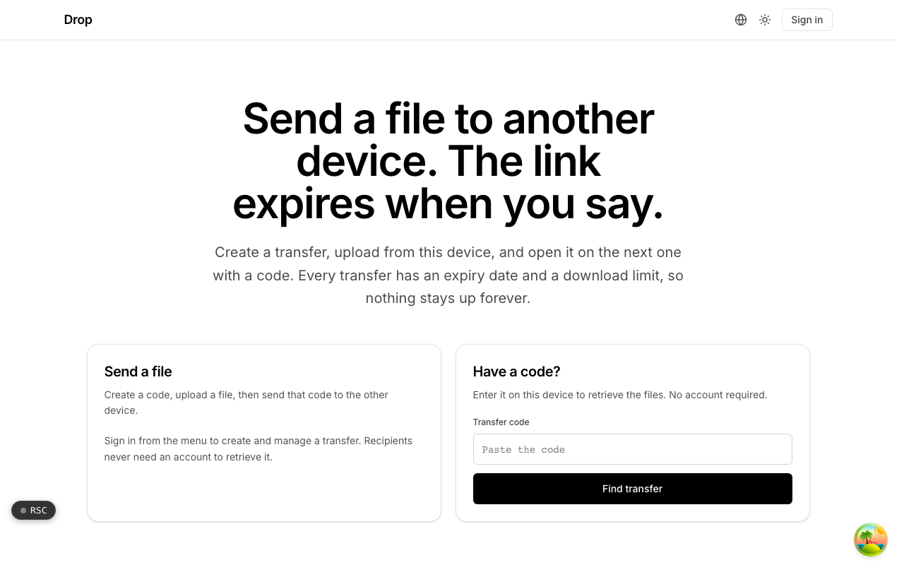
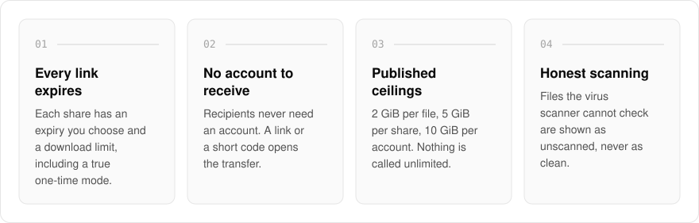
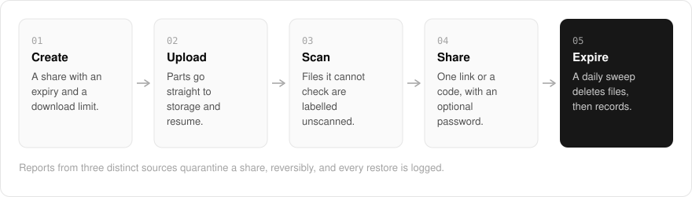

  <picture>
    <source media="(prefers-color-scheme: dark)" srcset=".github/assets/hero-dark.png">
    
  </picture>

<h1 align="center">drop.me.at</h1>

<strong>Send a file to another device. The link expires when you say.</strong>

  
  
  
  

  <a href="#features">Features</a> ·
  <a href="#how-it-works">How it works</a> ·
  <a href="#built-with">Built with</a>

Sending a big file usually means parking it in someone's cloud drive, where it stays for years after the one person who needed it has downloaded it. I built drop.me.at to send it once and let it go: create a transfer, upload from this device, and open it on the next one with a link or a code. Every transfer has an expiry date and a download limit, so nothing stays up forever, and recipients never need an account.

> **Status:** in development. The hosted version stays closed until its launch checklist (durable storage, a real virus scanner, bot protection on reports, and human review of the report queue) is complete.

  <picture>
    <source media="(prefers-color-scheme: dark)" srcset=".github/assets/overview-dark.svg">
    
  </picture>

## Why drop.me.at

| The usual file share | drop.me.at |
| --- | --- |
| Files stay up until someone remembers them | Every share expires, with a download limit |
| "Unlimited" storage with fine print | 2 GiB per file, 5 GiB per share, 10 GiB per account |
| Anything not flagged looks clean | A file the scanner cannot check says unscanned |
| The recipient needs an account | The recipient opens a link or a code |
| Deletion is a promise | A daily sweep removes files first, records second |

## Features

- **Expiring share links**: one link with an expiry you choose and a download limit, including a true one-time mode served directly rather than through a reusable presigned URL.
- **Optional password**: protect a share with a password on top of its unguessable 128-bit link.
- **Resumable uploads**: files go straight to storage in parts and resume after a dropped connection.
- **Published ceilings**: 2 GiB per file, 5 GiB per share, 10 GiB per account, and retention up to 30 days free or 90 days paid. Nothing is "unlimited".
- **Deletion you can count on**: a daily sweep removes expired files first and their records second.
- **Virus scanning, labelled honestly**: files the scanner cannot check are shown as unscanned, never as clean.
- **Moderation built in**: report intake, reversible quarantine after reports from three distinct sources, and logged restores.
- **Upload tokens and self-hosting**: an upload API lets a build or script create shares, and you can self-host against your own S3-compatible bucket.

## How it works

  <picture>
    <source media="(prefers-color-scheme: dark)" srcset=".github/assets/flow-dark.svg">
    
  </picture>

A share starts with its expiry and download limit, so the end is decided before the first byte moves. The file goes straight to storage in parts that resume after a dropped connection, and the scanner labels anything it could not check as unscanned. The recipient opens one link or a short code, with an optional password, and a daily sweep deletes the expired files and then their records.

## Built with

  
  
  
  
  
  

- Next.js 16 (App Router), React 19, TypeScript
- Tailwind CSS 4
- S3-compatible object storage (AWS SDK)
- oRPC + TanStack Query
- Drizzle ORM + Postgres
- ClamAV scanning and Cloudflare Turnstile
- Better Auth (shared `*.me.at` account)

## Part of the me.at family

drop.me.at is one of my [`*.me.at`](https://me.at) apps. They share one design system, account, and app shell. Development happens in a private monorepo; this repository is the project's public-facing home.

## License

Source-available. See [LICENSE](LICENSE).
